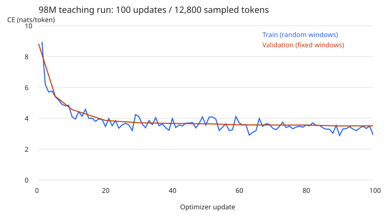

# Week 1: A From-Scratch 98M Language Model on Apple Silicon

**Status:** the declared, bounded teaching experiment is complete. This is not a fully pretrained model, a capability benchmark, or the final NeurIPS submission.

## Problem and motivation

Can a single-device pipeline, with a hand-written byte BPE tokenizer and decoder-only Transformer, actually optimize an approximately 0.1B-parameter model, resume from a checkpoint, and produce autoregressive output on a 16 GiB Apple Silicon machine?

The purpose is to establish a transparent correctness baseline before introducing fused kernels, distributed systems, alignment, or agent training. A toy model passing unit tests does not by itself establish that the billion-byte checkpoint and optimizer state paths work at the intended parameter scale.

## Method

We trained a randomly initialized **98,323,200-parameter** decoder with 12 blocks, width 768, 12 attention heads, SwiGLU width 2304, RoPE, RMSNorm and tied input/output embeddings. Attention, projections, normalization, RoPE, feed-forward layers and cross-entropy are implemented in this repository. PyTorch provides tensors, automatic differentiation, AdamW and the MPS runtime; neither a pretrained model nor a prebuilt Transformer/attention operator is used in production code.

The hardware was an **Apple M4, 10 GPU cores, 16 GiB unified memory**, using Python 3.12.12 and PyTorch 2.14.1 in FP32. See [manifest.json](manifest.json) for exact configuration, environment and source fingerprints.

We selected the first 512 stories from TinyStories' upstream training split and the first 128 stories from its validation split. Internal whitespace was normalized so each full story occupies one line. Exact duplicate documents and exact cross-split overlap were rejected. We did not perform near-duplicate or template-leakage auditing.

The dataset authors are **Ronen Eldan and Yuanzhi Li**. Its [dataset card](https://huggingface.co/datasets/roneneldan/TinyStories) declares [CDLA-Sharing-1.0](https://cdla.dev/sharing-1-0/). [data-source.json](data-source.json) preserves attribution, the modification notice, page URLs and content hashes. Raw text is not redistributed in this repository. Upstream API responses were not revision-pinned.

The byte BPE tokenizer was trained on training text only and learned 5,696 tokens; the model retained 8,192 embedding/output slots. Prepared training and validation streams contained 172,991 and 39,574 tokens respectively, including document EOS markers.

The declared budget was **100 optimizer updates × batch 1 × context 128 = 12,800 sampled training tokens**. We used AdamW with peak learning rate 0.0003, ten warmup updates, cosine decay to 10% of peak, weight decay 0.1 and gradient clipping at norm 1. Training stopped after update 5 and then resumed from the saved model, optimizer and RNG state to update 100.

Validation used the same four seeded windows at each evaluation: 512 predicted positions, with possible overlap. It is a small sampled estimate, not full-corpus perplexity. Attention permits crossing EOS boundaries in packed windows.

## Results

| Measurement | Observed value |
| --- | ---: |
| Parameters actually trained | 98,323,200 |
| Optimizer updates completed | 100 |
| Sampled training tokens | 12,800 |
| Initial validation CE, nats/token | 8.829942 |
| Final validation CE, nats/token | 3.513791 |
| First training-window CE | 8.958643 |
| Last training-window CE | 2.936069 |
| Checkpoint size, including optimizer | 1,179,993,355 bytes |
| Sum of synchronized training-step times | 33.495 seconds |

The timing figure **excludes downloading, tokenization, initialization, evaluation, checkpoint serialization and logging**. It is not end-to-end training time and should not be used as a hardware speedup claim. The first and last training losses are measured on different random windows; only validation reuses fixed windows.

The full numerical record is in [metrics.jsonl](metrics.jsonl), with computed totals and the local checkpoint hash in [summary.json](summary.json).

## Demo and failure analysis

The actual greedy completion for `Once upon a time` repeats the frequent word `the`; the full output is preserved in [generation.txt](generation.txt). This is a failure case, not an edited demonstration of coherent language generation.

At only approximately 0.00013 training tokens per parameter, the model is severely undertrained. A drop in next-token loss can reflect learning frequency and whitespace patterns rather than narrative ability. The dataset subset is tiny and prefix-selected, the validation sample is small, only one seed was run, and no capability evaluation or comparison against a trained baseline was performed.

Thus, the result establishes the **engineering training/resume/evaluation/generation loop at the intended parameter scale**, not sufficient pretraining, convergence, story-writing ability, or a compute-optimal training recipe. The larger `configs/100m.json` budget remains a separate, unexecuted experiment.

## Reproduction and artifacts

Commands and exact budget: [Week 1 runbook](../../docs/week1/runbook.md). Source explanations: [Week 1 learning guide](../../docs/week1/README.md).

The checkpoint remains at `runs/week1-100m-mac/latest.pt` on the execution machine. It is deliberately not committed to Git: the file exceeds GitHub's normal single-file limit, and a fresh clone must rerun the bounded experiment to obtain weights. This repository publishes lightweight evidence, configuration and source code, not a hosted model-weight download.

This is an AI-assisted independent learning implementation, not an assertion of compliance with any course's independent-work submission policy.
