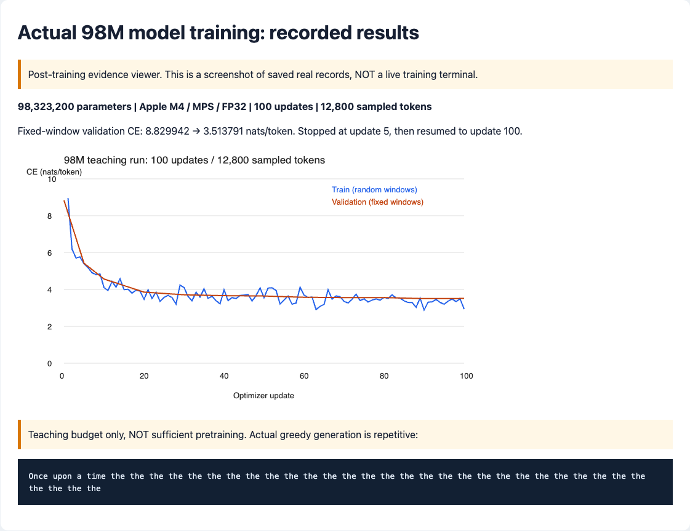

# 第一阶段：把文本变成一个会续写的模型

[回到总览](../../README.md) · 下一阶段：[让模型跑得更快](../02-systems/README.md)

**这一篇就是第一阶段的主文档。先看懂这篇，不需要同时打开逐行讲解。**

## 1. 任务是什么，做到什么才算完成

任务是：不直接拿别人的现成语言模型，自己写出“文字如何变成数字”和“模型如何根据前文预测后文”，再把约一亿个可调数字组成的模型真正训练起来。

想象输入一句话：

```text
输入：小猫坐在
目标：模型给出下一个文本片段的概率，例如“地毯”“窗边”……
生成：选一个片段接上去，再预测下一个，反复续写
```

这不是手写规则“遇到小猫就输出地毯”，而是让模型从大量例子中调整自己的数字，使正确续写更可能出现。**第一阶段先学会续写，不直接解决聊天、听指令或调用工具。**

本阶段要交三样东西：自己写的分词器、自己写的模型、可重放的训练和生成记录。还需要解释模型学到了什么、没学到什么，不能只给一个“运行成功”的截图。

**当前状态：实现与小预算教学实验完成；充分预训练未完成。** 这里的教学实验真实使用约一亿参数，但数据和训练次数远不足以让它具备可用的语言能力。

## 2. 先把这些名词说清楚

| 名词 | 在本任务里是什么意思 |
| --- | --- |
| 语言模型 | 根据前面一段文本，预测后面文本片段的程序。 |
| Token | 模型一次处理的文本单位，可以是一个字、一段词、一个标点，甚至一个字节；不等于一个完整单词。 |
| Tokenizer，分词器 | 在文字与 token 编号之间转换的工具。模型接收整数编号，不直接接收字符串。 |
| 词表 | token 编号与其代表内容的对应表。 |
| Byte，字节 | UTF-8 文本在计算机里的基础表示。中文和 emoji 通常需要多个字节；使用全体 256 种字节可以表示原词表没见过的文字。 |
| BPE，字节对编码 | 反复把高频相邻单位合并的分词方法。这里从字节开始合并，让常见片段用更少编号表示。 |
| 参数、权重 | 模型里训练时会调整的数字。0.1B 是约一亿个参数，不是训练了一亿字，也不是一亿条数据。 |
| Transformer | 本阶段自己写的模型结构：把编号转换为数值表示，分析前文关系，再输出下一个 token 的分数。 |
| 训练集 / 验证集 | 训练集用来调整参数；验证集不参与参数更新，用来检查模型在未用于训练的文本上表现如何。 |
| Loss，损失 | 衡量模型把正确答案预测得有多差的数值。在固定数据和计算方法下，通常越低越好；不等于“答错百分之几”。 |
| Step，训练步 | 这里指一次参数更新。不是读完一遍全数据，也不是生成一个字。 |
| Batch，批次 | 一次送进模型的若干段文本。本次大模型教学训练每批只有一段。 |
| Context，上下文 | 模型一次能看到的 token 数。本次训练窗口是 128 个 token，不是 128 个字。 |
| Checkpoint，训练快照 | 保存模型权重，以及继续训练所需的优化器和随机状态的文件。类似有内部状态的程序存档，不只是日志。 |
| 推理 / 生成 | 参数不再更新，用训练后的模型反复预测并接出文本。 |

这里面有两个不同的“学习”：**分词器学习哪些片段值得合并；模型学习这些片段怎样接续。** 学会分词不代表模型已经学会语言。

## 3. 整件事怎么串起来

```text
原始故事
  → 留出一部分故事作验证，不用于训练
  → 只用训练故事学习分词规则
  → 按同一套规则，把两份故事分别变成整数编号
  → 从训练编号中取一小段，构造“前文 → 下一个编号”
  → 模型给每个可能答案打分
  → 算出预测损失，调整参数
  → 定期用验证故事检查效果、保存快照
  → 用保存的模型真正续写一段文字
```

以假设的三个 token 为例，`[小猫, 坐在, 地毯]` 的编号可能是 `[10,20,30]`。这只是示意，不是本分词器实际词表。

```text
模型看到“小猫”       → 目标是“坐在”
模型看到“小猫 坐在”  → 目标是“地毯”
```

训练时会同时计算各位置的预测，但必须挡住后面的内容，否则模型能偷看答案。生成时没有现成答案，只能把自己刚选出的片段接回输入，再继续预测。

## 4. 实际先做了什么，后做了什么

### 第一步：先选一份够小、来源明确的语料

用了 **TinyStories**：一份由模型合成的英文短故事数据，作者为 Ronen Eldan 和 Yuanzhi Li，数据卡声明 CDLA-Sharing-1.0 许可证。取上游训练集前 512 篇、验证集前 128 篇，统一故事内部空白，让一行对应一个完整故事。

**为什么这样选：** 故事用词相对简单，下载量小，适合先把软件链路跑通；保留来源和许可信息，而不是随意抓一批无法交代来源的网页。**局限：** 这是前缀抽样，不代表整个数据集；只检查完全重复，没有审计近似重复。

### 第二步：自己写分词器，让文字可逆地变成编号

从全部 256 种字节开始，统计相邻片段，反复合并高频组合。例如 `banana` 最初可以拆为 `b a n a n a`，发现 `a n` 常出现，就用一个新编号代表 `an`。额外保留一个文档结束编号，叫 **EOS**，告诉模型故事结束了。

**为什么用 byte BPE：** 从字节起步不会因为出现新中文或 emoji 就无法编码；合并又能缩短常见文本，比每次只读一个字节更省序列长度。实现直观，便于手算检查。代价是当前频数重算实现不适合直接处理巨大语料。

本次设置最多 8192 个词表项，实际只学到 **5696 个**；语料小，不能凭设置值声称“学满了词表”。检查了中文、emoji、换行等文本转换后能否原样还原。

### 第三步：把故事编号整理成训练样本

把每篇故事编码并附加 EOS，写成紧凑的二进制文件。训练时用只读文件映射按需读取片段，不必把所有整数存成巨大的 Python 列表。

取 129 个编号时，前 128 个作输入，后 128 个作目标：

```text
原始： [10, 20, 30, 40]
输入： [10, 20, 30]
目标： [20, 30, 40]
```

上面用三个位置示意实际的 128 位置窗口。**目标错开一位，是为了预测下一个，而不是让模型复制当前输入。**

准备后训练文件有 172,991 个 token，验证文件有 39,574 个。训练窗口随机抽取，可能重复；窗口可以跨越故事结束标记，这是当前明确选择，不是每篇故事完全隔离。

### 第四步：自己写“怎么根据前文算出预测”

这里使用只看过去的 Transformer。内部各组件不必现在背公式，先理解它们各做一件什么事：

| 组件 | 作用与为什么需要它 |
| --- | --- |
| Embedding，编号向量表 | 把没有数值距离含义的整数编号查成一串可学习的数值，供后续计算使用。 |
| Linear，线性变换 | 用矩阵乘法混合特征，是模型里基础的数值加工步骤。 |
| Attention，注意力 | 让当前片段从前文不同位置取信息，而不是对所有前文一视同仁。 |
| Q / K / V | 注意力内部的三种表示：可以类比“我要找什么”“各位置提供什么线索”“实际取回什么内容”；这是理解比喻，不是文字检索规则。 |
| 多头注意力 | 同时用多组表示分析前文，再合并结果；不是调用多个独立模型。 |
| 因果遮罩 | 把未来位置挡住，避免训练时偷看下一个 token。 |
| RoPE，旋转位置编码 | 把位置信息加入注意力计算，让相同片段出现在不同位置时可被区分；本实现不为位置另设可训练参数表。 |
| RMSNorm，归一化 | 调整数值尺度，再学习各通道的缩放，帮助深层计算保持稳定。 |
| SwiGLU，带门控的前馈层 | 在每个位置进一步加工特征；一条分支控制另一条分支的信息通过程度。 |
| 残差连接 | 把层的输入加回输出，让信息和训练梯度更容易穿过多层。 |
| Logits / Softmax | Logits 是每个候选 token 的原始分数；Softmax 把分数转换成和为一的概率。 |

把这些组成 12 层，得到 **98,323,200 参数**的模型。输入的编号向量表也用于输出打分，叫“输入输出权重共享”，可以少存一份大表。

**为什么先用这套方案：** 它能覆盖现代语言模型的主要部件，又不必一开始引入更多并行与推理优化。允许 PyTorch 提供张量计算和自动求导，但分词器、注意力、层结构和预测损失自行实现；不用现成 Transformer 层或预训练权重。优化器使用 PyTorch 的 AdamW，不声称所有底层工具都从零写。

### 第五步：先检查模型有没有接错，再扩大参数量

先用约 14 万参数的小模型跑通整个流程，并做自动检查：改动未来输入不应影响过去输出；手写注意力和损失应与可靠参考算子一致；同一小批数据反复训练时损失应明显下降；正常中断恢复后的 CPU 结果应和连续训练一致。

**为什么先小后大：** 数学接错时，大模型一样可能运行、甚至损失下降，不能靠“跑起来”判断实现正确。小模型定位问题更快，也不浪费大模型资源。

### 第六步：真正训练约一亿参数的模型

在本机 **Apple M4、16 GiB 内存**上，使用 PyTorch 的 **MPS** 后端，也就是调用 Apple GPU 的运行方式。使用 **FP32**，即主要用 32 位浮点数计算，先避免额外的低精度问题。

模型先预测下一 token 的概率；用**交叉熵损失**惩罚“正确答案概率太低”；**反向传播**计算各参数应怎样变化；**AdamW 优化器**按照梯度和历史状态更新参数。**学习率**控制每次调整的幅度，前 10 步逐渐升高，之后逐渐降低；**梯度裁剪**限制过大的更新信号。

本次固定为 100 次更新，每次一段 128-token 输入，总共处理：

```text
100 步 × 每批 1 段 × 每段 128 个预测位置 = 12,800 个训练 token
```

这不是读完训练集，也不是 12,800 个不同 token。先停在第 5 步保存状态，再恢复到第 100 步，实际演示可继续训练。

**为什么只跑这个预算：** 这是你确认使用当前 Mac 的有界教学实验，目标是核实一亿级模型的真实训练、保存和恢复能不能工作；不是认为 100 步就足够训练好语言模型。另有 20,000 步配置，但没有执行，也不保证跑完那个配置就足够。

## 5. 效果怎样，数字到底说明什么

| 观察项 | 实际结果 | 正确解读 |
| --- | --- | --- |
| 参数数量 | 98,323,200 | 的确训练了一亿级模型，不是拿小模型冒充 |
| 验证损失 | 8.83 → 3.51 | 在固定抽样验证窗口上，正确 token 的预测整体改善；不是准确率 96.49% |
| 验证范围 | 4 个窗口，共 512 个预测位置 | 很小的抽样估计，窗口可能重叠，不能当作全面能力评测 |
| 训练预算 | 100 步，12,800 token | 只证明工程流程，对这个参数规模严重不足 |
| 实际生成 | `Once upon a time the the the ...` | 会反复输出常见词，没有学会可靠写故事 |
| 快照 | 约 1.18 GB，包含优化器状态 | 权重在本地，未把大文件塞进 Git；仓库有摘要、日志和截图 |

**为什么损失降了，文字还是很差？** 因为学会常见词、空格等局部分布就能降低损失，但连贯写故事还需要更充分的训练。反复选概率最大的 token，也容易把未训练好的模型带进重复循环。不能为了展示好看而隐藏这个结果。



这是**训练后读取真实记录的截图**，不是伪装成实时训练的终端。还重新读取了本地权重，核对参数数、文件摘要以及优化器确实执行到第 100 步；原始记录保留，截图不是唯一证据。

## 6. 要自己运行时，按这个顺序

下面是使用 Mac 重放同样教学预算的命令。**先从仓库根目录进入第一阶段文件夹**，后面的代码、配置与产物路径均相对于这个文件夹。`uv` 是 Python 环境和依赖管理工具，安装会创建独立环境，不往系统 Python 里混装依赖。

```bash
# 先进入第一阶段，后面的命令都在这里运行
cd stages/01-basics

# 0. 准备 Python 3.12 环境和依赖，再启用环境
uv sync --locked --python 3.12
source .venv/bin/activate

# 1. 下载小份训练故事和独立验证故事
python -m aml.tinystories --output data/week1-raw \
  --train-rows 512 --val-rows 128

# 2. 只用训练故事学习分词规则
python -m aml.tokenizer --input data/week1-raw/train.txt \
  --output data/week1-tokenizer.json --vocab-size 8192

# 3. 把两份故事按同一词表转成训练和验证编号文件
python -m aml.data --train data/week1-raw/train.txt \
  --val data/week1-raw/val.txt --tokenizer data/week1-tokenizer.json \
  --output data/week1-tokens

# 4. 真正训练大模型，先保存到第 5 步
python -m aml.train --config configs/100m-mac.json \
  --data data/week1-tokens --output runs/week1-100m-mac \
  --device mps --stop-after 5

# 5. 从快照继续到配置中的第 100 步
python -m aml.train --config configs/100m-mac.json \
  --data data/week1-tokens --output runs/week1-100m-mac \
  --device mps --resume

# 6. 读取权重，尝试续写；temperature=0 表示每次选分数最高的 token
python -m aml.generate --checkpoint runs/week1-100m-mac/latest.pt \
  --prompt "Once upon a time" --temperature 0 --max-new-tokens 64 --device mps
```

本机这些目录已经有原实验，**不要直接重复执行整段**：工具会拒绝覆盖非空目录。重跑必须给所有命令一致地更换数据与运行目录名。上面用于阅读顺序；历史实际命令使用 `.venv/bin/python`，并把输出重定向到文件，完整保存在[实际命令记录](reports/evidence/commands.txt)。

目录已从原来的仓库根目录归入本阶段；原始截图、日志和历史命令保持原样，避免改写证据。历史记录中的 `week1` 只是那次实验的旧文件名，不再是任务划分或完成期限；本地原数据与权重也已随阶段移入，内容未变。

## 7. 还缺什么，接下来与其他阶段怎么接

第一阶段最重要的未完成项，是用足够的数据与训练预算得到真正有用的模型，并扩大验证范围。另有两个已确认、尚未修复的恢复缺陷：日志末行写了一半时可能无法恢复；恢复入口不检查模型源码是否已经改变。本次原实验的日志与源码指纹已经额外核对，但不能因此说通用恢复机制没有问题。

第二阶段拿同一套模型计算去提速；第三阶段研究数据与训练规模，可能回头改进本阶段预训练；第四阶段拿经过足够预训练的模型训练具体行为；第五阶段再把模型放进工具和任务环境。**现在这个反复输出 `the` 的 checkpoint 不能直接当作后面阶段的合格基座。**

### 只有需要深挖时再打开

| 你想查什么 | 去哪里 |
| --- | --- |
| 某行代码在干什么 | [逐行讲解附录](docs/code/README.md) |
| 原始数据、曲线、日志和英文记录 | [实验报告](reports/README.md) |
| 核验截图、权重检查、历史完整命令 | [证据说明](docs/code/evidence.md) |
| 和参考项目相比有哪些缺口 | [对照检查](docs/references.md#用户补充项目后的对照检查) |
