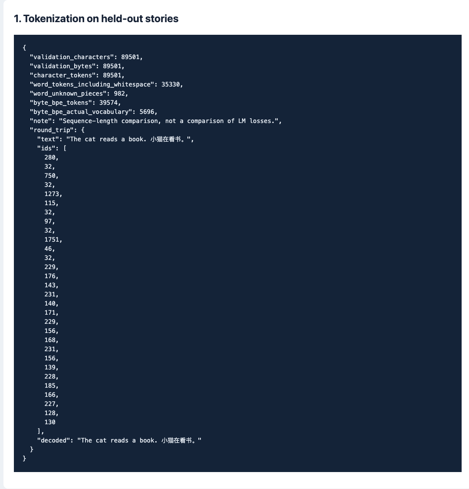
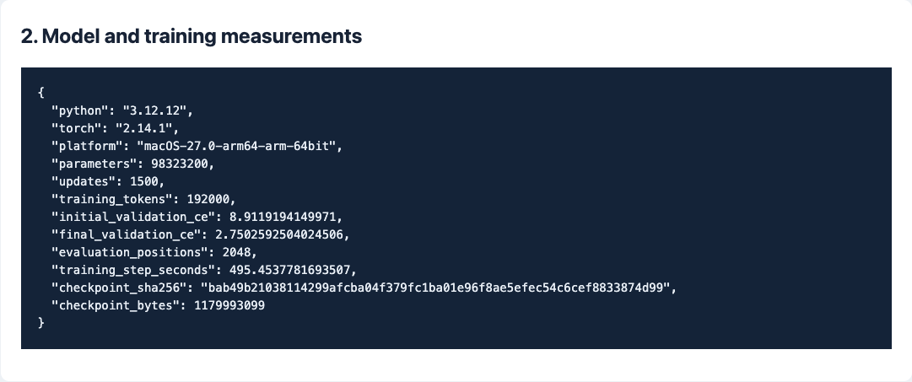
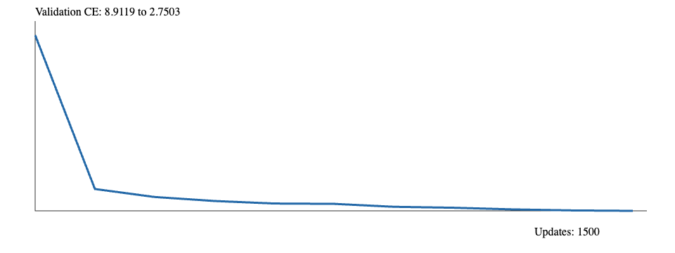
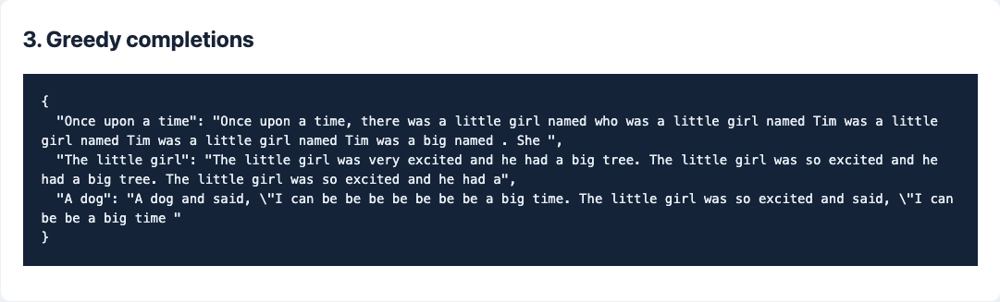
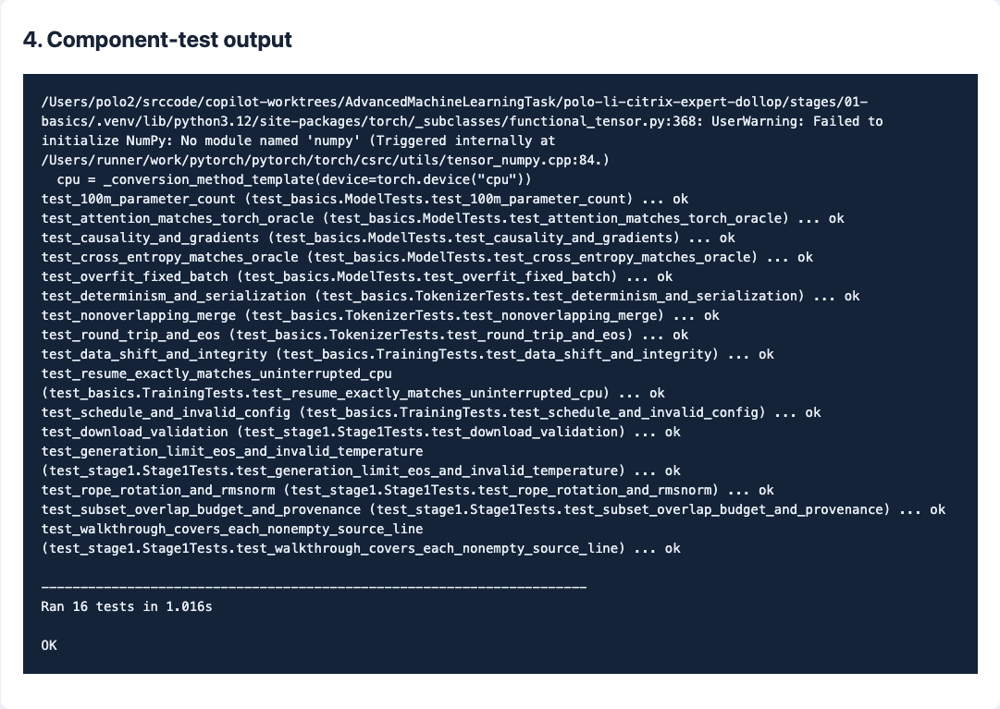

# 第一阶段：分词器、Transformer 与一亿参数训练

[总任务表](../../README.md) · [下一阶段](../02-systems/README.md)

## 任务清单

- [x] 从零实现 byte BPE 分词器，检查中文、英文和 emoji 编码后能原样还原。
- [x] 从零实现 Transformer，检查注意力、因果性、损失与梯度。
- [x] 比较字符、单词与 BPE 在同一份验证文本上的序列长度。
- [x] 训练 98,323,200 参数模型：先跑 100 步并演示恢复，再另跑 1,500 步。
- [x] 保存训练日志、验证曲线、生成样例、截图和可下载权重。

## 要解决的问题

让模型根据前文预测下一个文本片段。整条链路是：

```text
故事 → 分词器 → 整数编号 → Transformer → 下一个编号的概率
                                    ↓
                           与目标答案计算损失
                                    ↓
                               更新模型参数
```

训练时输入 `[10,20,30]`，目标是 `[20,30,40]`，也就是每个位置预测后面一个编号。生成时没有现成答案，把自己刚输出的编号接回去再预测。

## 用到的名词

| 名词与英文全称 | 在这里的作用 |
| --- | --- |
| Token，文本单位 | 模型一次处理的单位，不一定是一个字或一个单词。 |
| Tokenizer，分词器 | 把文字转换成整数编号，并能转换回来。 |
| BPE — Byte Pair Encoding，字节对编码 | 从字节开始，反复合并高频相邻片段，缩短序列。 |
| UTF-8 — 8-bit Unicode Transformation Format | 文字的字节编码；256 种字节足以表示没见过的中文或 emoji。 |
| EOS — End of Sequence，序列结束标记 | 这里用编号 256 标记一篇故事结束。 |
| Transformer | 根据前文计算下一 token 分数的网络结构。 |
| Embedding，嵌入 | 把编号查成可训练向量；本模型输入和输出共享这张表。 |
| Q / K / V — Query / Key / Value | 注意力中的查询、键和值：分别负责寻找、匹配和取回信息。 |
| MHA — Multi-Head Attention，多头注意力 | 用多组查询、键和值并行分析前文。 |
| RoPE — Rotary Position Embedding，旋转位置编码 | 给注意力加入相对位置关系。 |
| RMSNorm — Root Mean Square Normalization，均方根归一化 | 稳定各层数值尺度。 |
| SwiGLU — Swish Gated Linear Unit | 带门控的前馈网络，进一步加工每个位置的特征。 |
| CE — Cross-Entropy，交叉熵 | 正确答案的预测概率越低，损失越大；不是错误百分比。 |
| AdamW — Adaptive Moment Estimation with decoupled Weight Decay | 根据梯度与历史状态调整权重，并独立施加权重衰减。 |
| CPU / GPU — Central / Graphics Processing Unit | 中央处理器 / 图形处理器。 |
| MPS — Metal Performance Shaders | PyTorch 在本机调用 Apple GPU 的后端。 |
| FP32 — 32-bit Floating Point | 本次训练使用的 32 位浮点精度。 |
| Batch / Context / Step | 一批样本 / 一段样本的 token 长度 / 一次参数更新。 |
| Checkpoint，训练快照 | 包含权重、优化器和随机状态，用于恢复训练。 |

## 实现记录

| 顺序 | 实际做的事 | 对应实现 |
| --- | --- | --- |
| 1 | 下载 TinyStories 前 512 篇训练故事、128 篇验证故事；保留来源、许可和文件摘要 | [tinystories.py](aml/tinystories.py) |
| 2 | 只在训练故事上统计合并规则；设置最多 8192 项，实际学到 5696 项 | [tokenizer.py](aml/tokenizer.py) |
| 3 | 把故事编码为小端 uint32 文件；读入时随机抽窗口，目标右移一位 | [data.py](aml/data.py) |
| 4 | 写 12 层、宽度 768、12 头、前馈宽度 2304 的网络 | [model.py](aml/model.py) |
| 5 | 先检查小模型过拟合、因果遮罩、梯度和恢复，再训练一亿参数模型 | [测试](tests/test_basics.py)、[训练器](aml/train.py) |
| 6 | 固定验证窗口评估；加载权重生成三组文本 | [检查与记录脚本](scripts/inspect_pipeline.py) |

选择 TinyStories 是为了先用简单英文故事检查整条训练链路；选择 byte BPE 是为了兼顾可逆性和序列长度。先保留显式矩阵注意力，便于与参考数值核对，再在第二阶段测优化。

PyTorch 提供张量、自动求导和 AdamW；分词器、线性层、归一化、位置编码、注意力、前馈层和损失由本仓库实现。

数据来自 Ronen Eldan 与 Yuanzhi Li 的 [TinyStories](https://huggingface.co/datasets/roneneldan/TinyStories)，按 CDLA（Community Data License Agreement）Sharing-1.0 发布。抽样与空白规范化等修改记录在数据包的 NOTICE 和 source.json。

## 实验结果

设备：Apple M4、16 GiB 内存，MPS，FP32。下面是新跑的 1,500 步实验；[原 100 步记录](reports/README.md)保留不改。

| 项目 | 实测 |
| --- | --- |
| 参数量 | 98,323,200 |
| 训练预算 | 1,500 次更新 × 1 段 × 128 token = 192,000 token |
| 训练 / 验证文件 | 172,991 / 39,574 token |
| 验证方法 | 固定 16 个 128-token 窗口，共 2,048 个预测位置 |
| 验证 CE | 8.9119 → **2.7503** |
| 累计训练步耗时 | 495.45 秒，不含评估、保存与数据准备 |
| 完整快照大小 | 1,179,993,099 bytes，含优化器状态 |
| 快照 SHA-256（Secure Hash Algorithm, 256-bit） | `bab49b21038114299afcba04f379fc1ba01e96f8ae5efec54c6cef8833874d99` |

同一份验证文本的分词对照：

| 方法 | token 数 | 观察 |
| --- | --- | --- |
| 字符 | 89,501 | 每个字符一个单位 |
| 单词，保留空白片段 | 35,330 | 有 982 个片段不在训练词表里 |
| Byte BPE | 39,574 | 不需要未知词占位，英文序列比字符短 |

本表比较序列长度和未知片段数量；语言模型损失在固定分词器下另行评估。

实际贪心生成：

```text
Once upon a time, there was a little girl named who was a little girl named Tim ...

The little girl was very excited and he had a big tree. The little girl was so excited ...
```

比原来连续输出 `the` 多学到了一些词组，但仍有重复、语法与指代错误。后续增加独立故事数量，比较扩充数据与重复训练的差别；损失和生成质量分别记录。

## 实际命令

从仓库根目录进入本阶段。数据包解压后可跳过下载、分词和编码；重训请使用新的输出目录，避免覆盖已有实验。

```bash
cd stages/01-basics
uv sync --locked --python 3.12

# 下载、学习分词规则、编码
.venv/bin/python -m aml.tinystories --output data/week1-raw --train-rows 512 --val-rows 128
.venv/bin/python -m aml.tokenizer --input data/week1-raw/train.txt --output data/week1-tokenizer.json --vocab-size 8192
.venv/bin/python -m aml.data --train data/week1-raw/train.txt --val data/week1-raw/val.txt --tokenizer data/week1-tokenizer.json --output data/week1-tokens

# 本次实际训练与结果整理
.venv/bin/python -m aml.train --config configs/100m-local.json --data data/week1-tokens --output runs/local-1500 --device mps --threads 1 > runs/local-1500.stdout.jsonl
.venv/bin/python -m scripts.inspect_pipeline > runs/local-1500-inspection.json
```

旧实验使用 `week1` 作为文件名中的运行标识。逐行说明收在[代码附录](docs/code/README.md)。

## 数据与权重

小份原文、编码数据、分词器和两次训练的元数据随仓库保存在 [training-data.zip](artifacts/training-data.zip)，约 0.5 MB。授权和修改说明见 [DATA_NOTICE.txt](artifacts/DATA_NOTICE.txt)。

完整权重放同仓库 Releases，不塞进 Git 历史：

| 实验 | 下载 |
| --- | --- |
| 原 100 步，包含恢复状态 | [stage1-100-updates](https://github.com/zongyangbigpolo/AdvancedMachineLearningTask/releases/tag/stage1-100-updates) |
| 新 1,500 步，包含恢复状态 | [stage1-1500-updates](https://github.com/zongyangbigpolo/AdvancedMachineLearningTask/releases/tag/stage1-1500-updates) |

```bash
# 仍在 stages/01-basics/；解压不会覆盖已有文件
unzip -n artifacts/training-data.zip
gh release download stage1-1500-updates --repo zongyangbigpolo/AdvancedMachineLearningTask \
  --pattern latest.pt --dir runs/local-1500
shasum -a 256 runs/local-1500/latest.pt
.venv/bin/python -m aml.generate --checkpoint runs/local-1500/latest.pt \
  --prompt "Once upon a time" --temperature 0 --max-new-tokens 64 --device mps
```

## 实验截图

以下截图来自本次保存记录的浏览器页面；原始数值和完整日志分别在 [results.json](reports/local/results.json)、[metrics.jsonl](reports/local/metrics.jsonl) 和 [tests.log](reports/local/tests.log)。

**分词对照与可逆性**



**一亿参数模型的训练记录与曲线**




**三组实际生成与组件检查**



