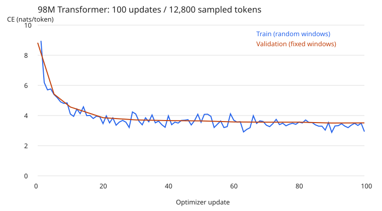
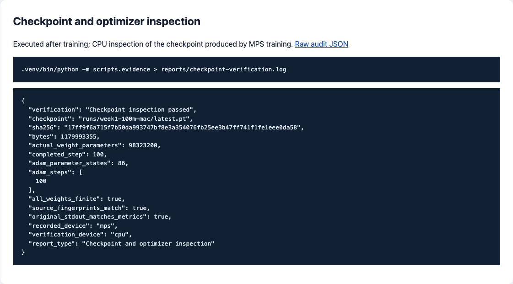
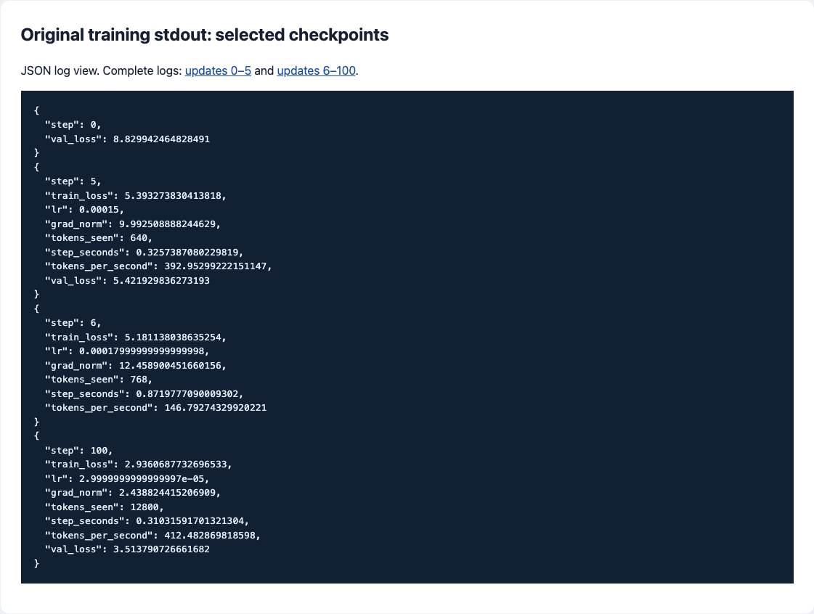

# Experiment 1: 98M Transformer, 100 updates

[Stage report](../README.md) · [1,500-update experiment](local/results.json)

## Task and motivation

Train the 98M model on Apple M4, save after update 5, restore the model
and optimizer states, and continue to update 100. This experiment checks
the training, checkpoint, evaluation, and generation interfaces before
increasing the budget.

## Method

The model has 98,323,200 parameters: 12 layers, width 768, 12 heads,
feed-forward width 2,304, vocabulary capacity 8,192, and tied embeddings.
The architecture uses Root Mean Square Normalization (RMSNorm), Rotary
Position Embedding (RoPE), causal attention, and Swish Gated Linear Units
(SwiGLU). PyTorch supplies tensors, automatic differentiation, AdamW,
and the Metal Performance Shaders (MPS) backend.

Hardware: Apple M4, 10 GPU cores, 16 GiB unified memory. Software:
Python 3.12.12, PyTorch 2.14.1, 32-bit floating point. Configuration and
source fingerprints are recorded in [manifest.json](manifest.json).

The TinyStories subset contains 512 training and 128 validation stories.
The authors are Ronen Eldan and Yuanzhi Li; the dataset uses
[CDLA-Sharing-1.0](https://cdla.dev/sharing-1-0/).
[data-source.json](data-source.json) records source URLs, modification
notices, and file hashes. The BPE (Byte Pair Encoding) tokenizer is fit
only on training text and contains 5,696 symbols.

Training uses batch one, context 128, peak learning rate 0.0003,
10 warmup updates, cosine decay to 10% of peak, weight decay 0.1,
and gradient clipping at norm one. Validation uses four fixed windows,
512 predicted positions, with possible overlap.

## Commands

Run from `stages/01-basics/`. The [command log](evidence/commands.txt)
also includes download, tokenization, encoding, and generation.

```bash
.venv/bin/python -m aml.train \
  --config configs/100m-mac.json --data data/week1-tokens \
  --output runs/week1-100m-mac --device mps --stop-after 5 \
  > runs/week1-training-first.log
.venv/bin/python -m aml.train \
  --config configs/100m-mac.json --data data/week1-tokens \
  --output runs/week1-100m-mac --device mps --resume \
  > runs/week1-training-resume.log
.venv/bin/python -m scripts.evidence > reports/checkpoint-verification.log
```

The checkpoint inspection counts parameters, checks finite weights and
Adam steps, compares file hashes, and checks log continuity.
Output: [checkpoint-verification.log](checkpoint-verification.log),
[audit.json](evidence/audit.json).

## Results

| Measurement | Value |
| --- | ---: |
| Parameters | 98,323,200 |
| Updates | 100 |
| Sampled training tokens | 12,800 |
| Initial validation CE (Cross-Entropy), nats/token | 8.829942 |
| Final validation CE, nats/token | 3.513791 |
| First / last training-window CE | 8.958643 / 2.936069 |
| Checkpoint, including optimizer | 1,179,993,355 bytes |
| Sum of training-step times | 33.495 seconds |

Step timing excludes data preparation, evaluation, logging, and
checkpoint serialization. Training windows vary; validation windows
remain fixed.



The greedy completion repeats `the`; see [generation.txt](generation.txt).
The model has learned frequent-token patterns at this budget, while
story coherence remains poor. Further evaluation uses the longer run
documented in the stage report.

## Artifacts and screenshots

The [data bundle](../artifacts/training-data.zip) includes the subset,
tokenizer, encoded streams, and run metadata. The full checkpoint is in
[stage1-100-updates](https://github.com/zongyangbigpolo/AdvancedMachineLearningTask/releases/tag/stage1-100-updates).

Training records:
[first segment](evidence/week1-training-first.log),
[resumed segment](evidence/week1-training-resume.log),
[metrics](metrics.jsonl), [summary](summary.json).




