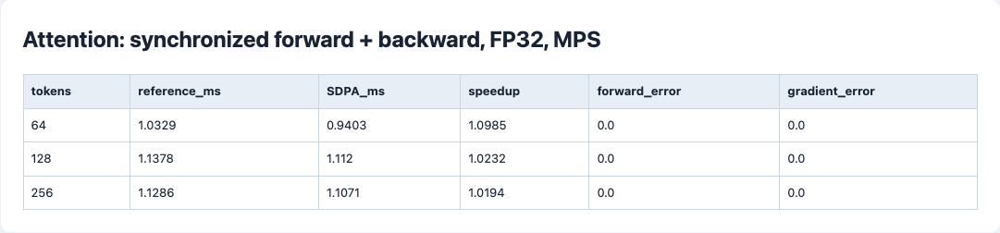
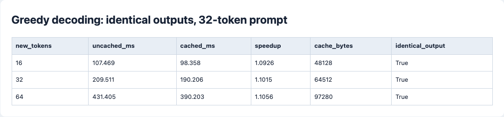

# 第二阶段：注意力与生成性能

[总任务表](../../README.md) · [上一阶段](../01-basics/README.md) · [下一阶段](../03-data-scaling/README.md)

## 任务清单

- [x] 对比手写注意力与 PyTorch SDPA 的输出、梯度及耗时。
- [x] 手写逐层 KV Cache，检查分块预填充与逐 token 解码结果。
- [x] 在 Apple M4 上测量有无缓存的生成延迟、输出一致性及缓存大小。
- [ ] Triton Attention Kernel：未实现与实测。
- [ ] 多 GPU 训练与推理增益：未实测。

## 实现与名词

| 名词与英文全称 | 本阶段做法 |
| --- | --- |
| GPU — Graphics Processing Unit | 实验设备为 Apple M4 图形处理器。 |
| MPS — Metal Performance Shaders | 性能实验使用的 PyTorch 后端。 |
| FP32 — 32-bit Floating Point | 所有对照都使用相同精度。 |
| SDPA — Scaled Dot-Product Attention | 缩放点积注意力；调用 PyTorch 实现作数值与性能对照。 |
| KV Cache — Key-Value Cache | 保存每层历史键和值；生成新 token 时只计算新位置。 |
| RoPE — Rotary Position Embedding | 缓存解码时必须沿用原位置偏移，不能每个新 token 都从位置 0 开始。 |
| Kernel，计算内核 | 在 GPU 上执行的计算程序；Triton 是编写此类程序的语言与工具名称，不是缩写。 |
| CUDA — Compute Unified Device Architecture | NVIDIA GPU 的计算平台；实验设备不支持此后端。 |
| DDP — Distributed Data Parallel | 各卡保留模型副本、处理不同数据并同步梯度；尚未做硬件实验。 |

[experiment.py](experiment.py) 保留显式注意力作参考，另写 `CachedDecoder`。缓存逐层保留 K/V，追加时只对新 Q/K 加入正确位置编码。当前实现使用固定上下文窗口，超过长度时抛出错误。

[测试](test_experiment.py)覆盖了多样本、分块预填充、逐步 logits、缓存字节数、上下文越界、批量变化，以及注意力反向梯度。

## 实验记录

在没有其他模型训练运行时计时。每轮先预热两次，计时前后等待 GPU 完成计算，避免把异步提交时间当成实际计算时间。表内是重复运行的中位数，完整最小 / 最大值见 [results.json](reports/results.json)。

**注意力前向 + 反向，重复 7 次，单位 ms**

| 序列长度 | 手写版 | PyTorch SDPA | 加速比 | 输出 / 梯度最大绝对误差 |
| --- | --- | --- | --- | --- |
| 64 | 1.0329 | 0.9403 | 1.098× | 0 / 0 |
| 128 | 1.1378 | 1.1120 | 1.023× | 0 / 0 |
| 256 | 1.1286 | 1.1071 | 1.019× | 0 / 0 |

**贪心生成，32-token 输入，重复 5 次，单位 ms**

| 新生成 token | 每次重算前文 | 使用缓存 | 加速比 | 输出相同 | 缓存 bytes |
| --- | --- | --- | --- | --- | --- |
| 16 | 107.469 | 98.358 | 1.093× | 是 | 48,128 |
| 32 | 209.511 | 190.206 | 1.101× | 是 | 64,512 |
| 64 | 431.405 | 390.203 | 1.106× | 是 | 97,280 |

生成对照使用 2 层、宽度 64 的固定随机权重模型，比较计算耗时。注意力测试的形状为 batch=1、4 heads、head_dim=16。

## 复盘

缓存消除了历史位置的重复投影和前馈计算。这里网络小、序列短，运行调度占比高，收益约 10%。注意力两种实现的计时区间有重叠；大模型、长序列和 Triton 内核需要各自测量。

## 复现命令

第一阶段环境安装后，从仓库根目录运行：

```bash
cd stages/02-systems
../01-basics/.venv/bin/python -m unittest -v
../01-basics/.venv/bin/python experiment.py --device mps
../01-basics/.venv/bin/python ../01-basics/scripts/render_reports.py --stage 02-systems
```

命令将重新生成性能报告。设备负载会影响延迟，因此复现时应保持其他训练任务停止。

## 实验截图

截图对应[测量记录页面](reports/index.html)。

**注意力数值和前后向性能**



**相同输出下的缓存收益**


