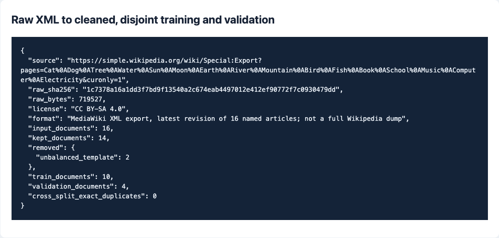
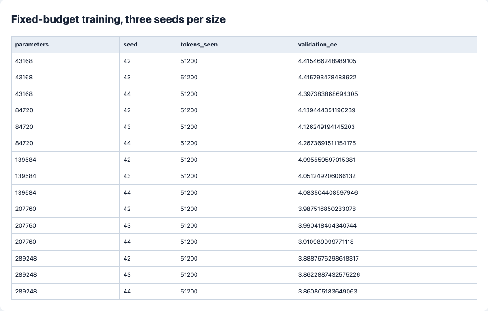
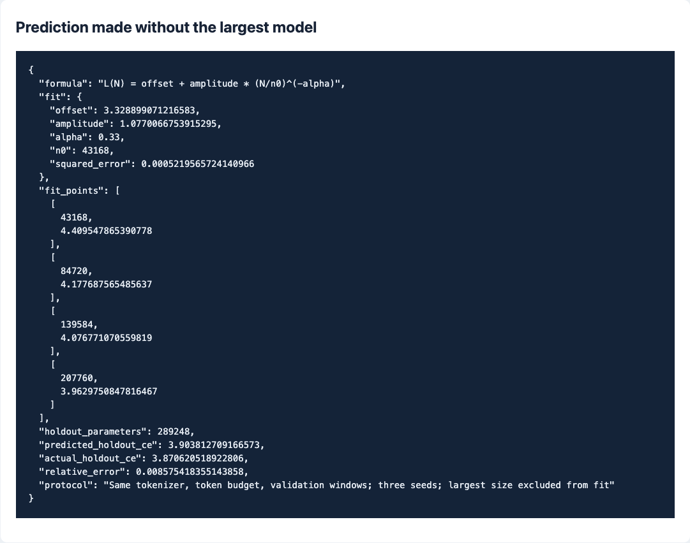

# 第三阶段：原始数据清洗与规模外推

[总任务表](../../README.md) · [上一阶段](../02-systems/README.md) · [下一阶段](../04-alignment/README.md)

## 任务清单

- [x] 下载 MediaWiki 原始 XML 导出，记录来源、版本和文件摘要。
- [x] 解析正文，去模板、引用、标记与重复文本，记录每类删除数量。
- [x] 按文章划分训练和验证，只在训练集学习分词规则。
- [x] 训练 5 个模型规模，每个规模使用 3 个随机种子。
- [x] 用前 4 个规模拟合，先预测第 5 个规模，再对照实测。
- [x] 上传原始快照、清洗数据、小模型权重、数据卡和截图。

## 问题与方法

这次检查两件事：原始网页标记能不能变成模型可读的语料；在相同训练 token 预算下，较小模型的结果能否预测较大模型。

| 名词与英文全称 | 这次的处理 |
| --- | --- |
| Dump，数据转储 | 本实验使用 Simple English Wikipedia 的 16 篇指定文章原始 XML 导出。 |
| XML — Extensible Markup Language | 导出里包着标题、修订版本、正文和站点信息；先解析结构，再处理正文。 |
| BPE — Byte Pair Encoding | 只在清洗后的训练文章上学习，所有模型共享同一个 512 项词表。 |
| 精确去重 | 用规范化文本摘要检查完全重复。 |
| 近似去重 | 文本切成连续 5 词片段集合，Jaccard 相似度达到 0.8 就去除。 |
| Jaccard Similarity，杰卡德相似度 | 两集合交集大小 ÷ 并集大小。 |
| Scaling Law，规模法则 | 用模型参数量与验证损失之间的幂律关系拟合本次数据。 |
| Hold-out，留出检验 | 最大规模不参加拟合，只用来检查预测。 |
| CPU — Central Processing Unit | 本次 15 个规模实验用 CPU 单线程运行。 |
| CE — Cross-Entropy | 固定分词器、验证窗口后的交叉熵，单位为 nats/token。 |

实现集中在 [experiment.py](experiment.py)。下载后保留原始 XML，去掉嵌套模板、引用、链接和部分表格；不平衡模板记录为明确删除原因，不静默吞掉。近似去重在划分前完成，随后按文章分组，训练和验证不交叉。

集合较小，去重使用两两比较；规模扩大后，这一步的二次复杂度会成为性能瓶颈。

## 清洗记录

| 项目 | 实测 |
| --- | --- |
| 原始导出 | 719,527 bytes，16 篇文章 |
| 许可 | CC BY-SA 4.0（Creative Commons Attribution-ShareAlike 4.0 International） |
| 保留 | 14 篇 |
| 删除 | 2 篇：模板括号不平衡 |
| 训练 / 验证 | 10 / 4 篇，按文章划分 |
| 跨集合精确重复 | 0 |
| 去重阈值 | 5 词片段集合的 Jaccard ≥ 0.8 |

文章修订链接、原始文件摘要、变换规则和编码后的 token 数见 [data-card.json](reports/data-card.json)。质量规则包括长度、字母比例、模板结构和重复率。

## 规模实验

所有模型为 2 层、4 头，前馈宽度为模型宽度的 3 倍。固定上下文 64、batch 8、100 步，即每次实验 51,200 个训练 token；每个规模使用种子 42、43、44，验证用同一组固定窗口。

| 参数量 | 平均验证 CE | 是否参加拟合 |
| --- | --- | --- |
| 43,168 | 4.4095 | 是 |
| 84,720 | 4.1777 | 是 |
| 139,584 | 4.0768 | 是 |
| 207,760 | 3.9630 | 是 |
| 289,248 | 3.8706 | 否，用于检验预测 |

拟合公式：

```text
L(N) = 3.328899 + 1.077007 × (N / 43168)^(-0.33)

预测最大模型：3.903813
最大模型实测：3.870621
相对误差：   0.8575%
```

## 复盘

固定数据量下，较大模型的验证损失更低。模型均训练 100 步，拟合描述的是该预算与参数范围内的局部关系；数据量、计算量和收敛后损失尚未作为独立维度展开。留出误差为 0.86%，后续更远范围的外推需要增加检验点。

最大规模的种子 42 权重作为第四阶段共同起点；后续三种方法不各选不同的最好模型。

## 实际命令与数据

```bash
cd stages/03-data-scaling
mkdir -p runs
../01-basics/.venv/bin/python -m unittest -v
../01-basics/.venv/bin/python experiment.py --steps 100 > runs/scaling.stdout.jsonl
../01-basics/.venv/bin/python ../01-basics/scripts/render_reports.py --stage 03-data-scaling
```

模型输出目录非空时会拒绝覆盖。

[data-and-models.zip](artifacts/data-and-models.zip)包含本次原始 XML、清洗文本、token 文件、分词器和全部 15 个小模型，以及同内容的 `holdout.pt`。展开后可直接查看或加载，不必重新下载实时变化的文章。许可和修改说明见 [DATA_NOTICE.txt](artifacts/DATA_NOTICE.txt)。

```bash
unzip -n artifacts/data-and-models.zip
# 重放同一个原始快照，使用新模型目录
../01-basics/.venv/bin/python experiment.py --steps 100 \
  --xml data/wiki-export/export.xml --output runs/replay
```

## 实验截图

完整原始数字见 [results.json](reports/results.json)，截图来自它的[记录页面](reports/index.html)。

**原始导出与清洗数量**



**15 次实际训练**



**留出最大模型后的外推检验**


