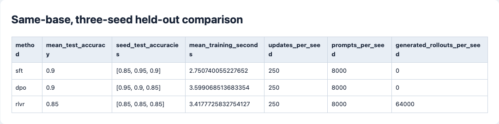
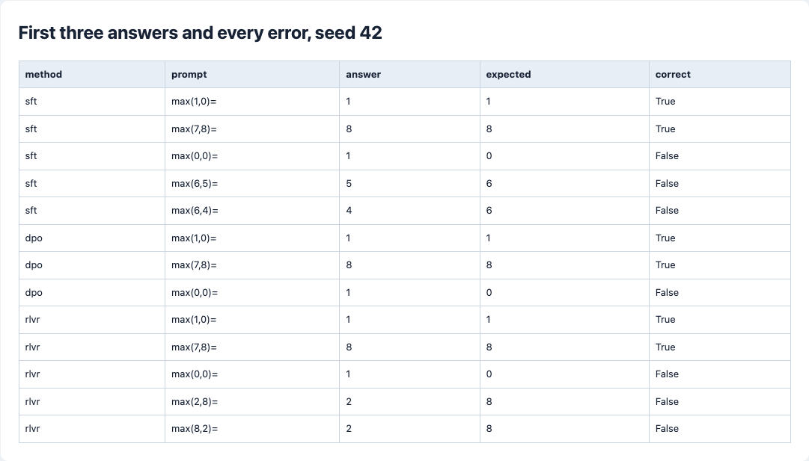
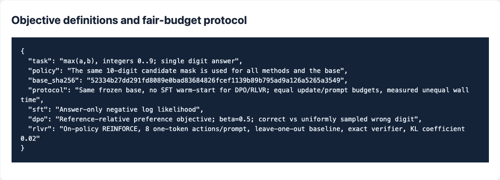

# 第四阶段：同基座 SFT、DPO、RLVR 对照

[总任务表](../../README.md) · [上一阶段](../03-data-scaling/README.md) · [下一阶段](../05-agents/README.md)

## 任务清单

- [x] 冻结同一份模型和分词器，记录共同起点的文件摘要。
- [x] 生成训练 / 测试不重叠的可验证任务。
- [x] 实现并训练 SFT、DPO、RLVR 三个分支，每个分支跑 3 个种子。
- [x] 统一测试，记录正确率、训练时间、采样量和错误样例。
- [x] 保存全部分支权重、任务数据与实验截图。

## 实验设置

任务是 `max(a,b)`：给两个 0～9 的整数，输出较大的一个。把 100 种组合固定打乱，80 题训练、20 题测试。所有方法只能输出同样的十个数字候选，正确答案由程序检查，不需要模型裁判。

| 设置 | 取值 |
| --- | --- |
| 共同基座 | 第三阶段 289,248 参数、宽度 96、种子 42 的预训练权重 |
| 基座 SHA-256（Secure Hash Algorithm, 256-bit） | `52334b27dd291fd8089e0bad83684826fcef1139b89b795ad9a126a5265a3549` |
| 各分支起点 | 全部直接从该基座出发；DPO、RLVR 没有额外先做 SFT |
| 训练预算 | 每种方法每个种子 250 步、每批 32 题，共 8,000 次题目呈现 |
| 随机种子 | 42、43、44 |
| 设备 | CPU（Central Processing Unit），单线程 |

使用小模型降低多种子对照的计算成本。该基座用于数字任务；第一阶段的一亿参数模型用于故事续写。

## 三种训练分别做了什么

| 名词与英文全称 | 实现 |
| --- | --- |
| SFT — Supervised Fine-Tuning，监督微调 | 只在答案位置计算正确数字的负对数概率。 |
| DPO — Direct Preference Optimization，直接偏好优化 | 同题的正确数字为 chosen，均匀抽取错误数字为 rejected；用相对冻结参考模型的概率差训练，β=0.5。 |
| RLVR — Reinforcement Learning with Verifiable Rewards，可验证奖励强化学习 | 当前策略为每题采样 8 个单 token 答案；答对奖励 1，答错 0；用策略梯度更新，而不是拿标准答案直接算监督损失。 |
| RL — Reinforcement Learning，强化学习 | 通过行动结果的奖励调整策略。 |
| RLOO — REINFORCE Leave-One-Out | 一个答案的基线是同组其余 7 个答案的平均奖励，自己的奖励不进入自己的基线。 |
| KL — Kullback–Leibler Divergence，相对熵 | RLVR 额外约束策略偏离初始模型的程度，系数 0.02。 |
| Verifier，验证器 | `answer == max(a,b)`，训练奖励和测试验收都能复查。 |

[experiment.py](experiment.py)包含三个训练分支。[测试](test_experiment.py)检查训练 / 测试划分、偏好损失方向、同策略起点的 `log(2)` 损失，以及 leave-one-out 是否排除当前奖励。

三种方法统一做：

```text
相同基座 → 相同题目分布 → 相同数字候选范围
        → 不同训练目标 → 相同 20 道未见题
```

## 实测结果

未做后训练的共同基座正确率为 **5%**。

| 方法 | 种子 42 | 种子 43 | 种子 44 | 平均正确率 | 平均训练循环耗时 |
| --- | --- | --- | --- | --- | --- |
| SFT | 85% | 95% | 90% | **90%** | 2.751 秒 |
| DPO | 95% | 90% | 85% | **90%** | 3.599 秒 |
| RLVR | 85% | 85% | 85% | **85%** | 3.418 秒 |

每个 RLVR 种子实际采样 **64,000 个答案**。因此这里等的是更新步数与题目数，不是严格相同的计算成本。耗时包含各自训练循环中的参考模型计算和采样，不含加载、初始评估、最终评估或存盘。

逐种子记录、测试答案和错误见 [results.json](reports/results.json)。

种子 42 的错误包括：SFT 把 `max(6,5)` 答成 5，DPO 在 `max(0,0)` 上答成 1，RLVR 把 `max(2,8)` 答成 2。

## 复盘

这组任务中 SFT 和 DPO 平均相同，RLVR 没有胜过它们。三种信号都比初始模型更适合当前任务，但奖励训练并不会因为名字不同就天然更强。

这次固定随机划分把唯一答案为 0 的题 `max(0,0)` 留到了测试集，训练答案没有覆盖 0。三个分支都在这题失败，是成绩中的一个共同数据因素，不全是优化算法差别。

测试只有 20 道数字题；采用固定候选、单 token 回答，没有测自由文本推理或多步算术。结果回答的是这个实验问题，不用于给通用语言模型能力排名。

## 实际命令、数据和权重

先在第三阶段解压数据与模型包，再运行：

```bash
cd stages/04-alignment
mkdir -p runs
../01-basics/.venv/bin/python -m unittest -v
../01-basics/.venv/bin/python experiment.py --steps 250 > runs/alignment.stdout.jsonl
../01-basics/.venv/bin/python ../01-basics/scripts/render_reports.py --stage 04-alignment
```

[alignment-models.zip](artifacts/alignment-models.zip)包含 9 个分支权重、分词器和实际题目划分。解压即可加载；`SHA256.json` 可核对每个文件。

```bash
unzip -n artifacts/alignment-models.zip
# 想重训时使用新目录，不覆盖已有分支
../01-basics/.venv/bin/python experiment.py --steps 250 --output runs/alignment-repeat
```

## 实验截图

截图来自[实测记录页面](reports/index.html)。

**同基座、三种子成绩与成本**



**各分支实际输出，保留错误**



**实际目标函数与约束**


