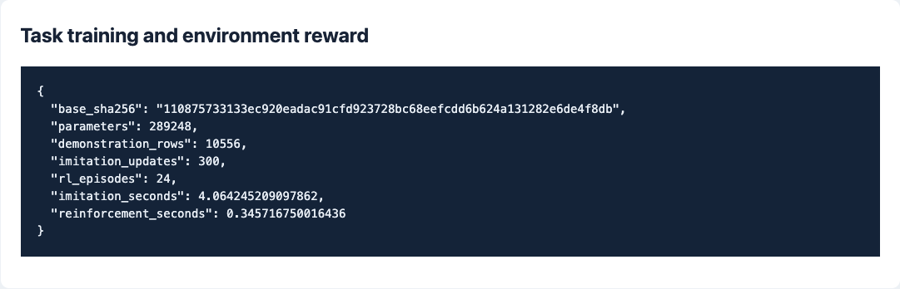
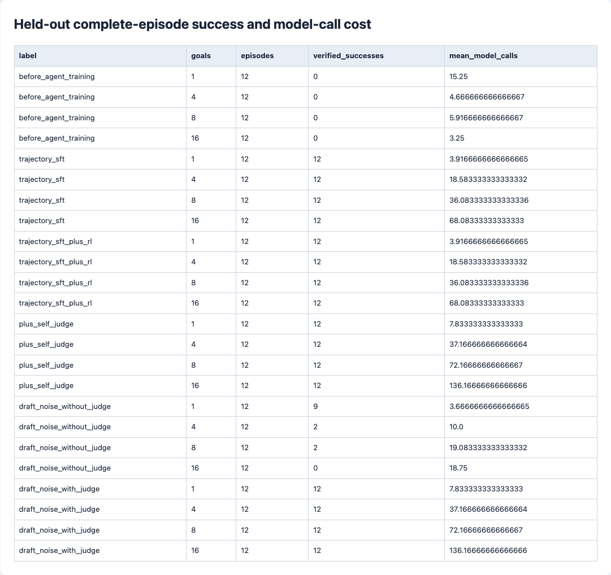
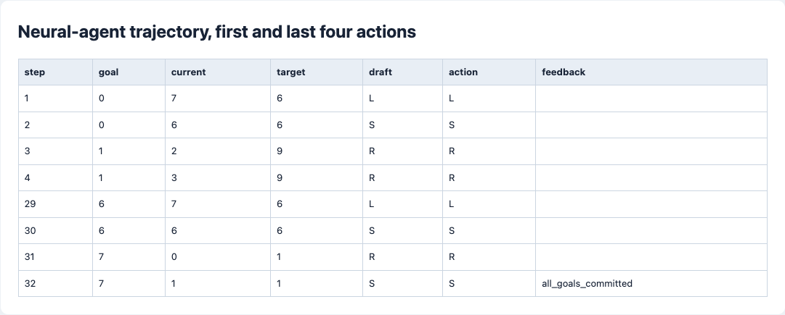
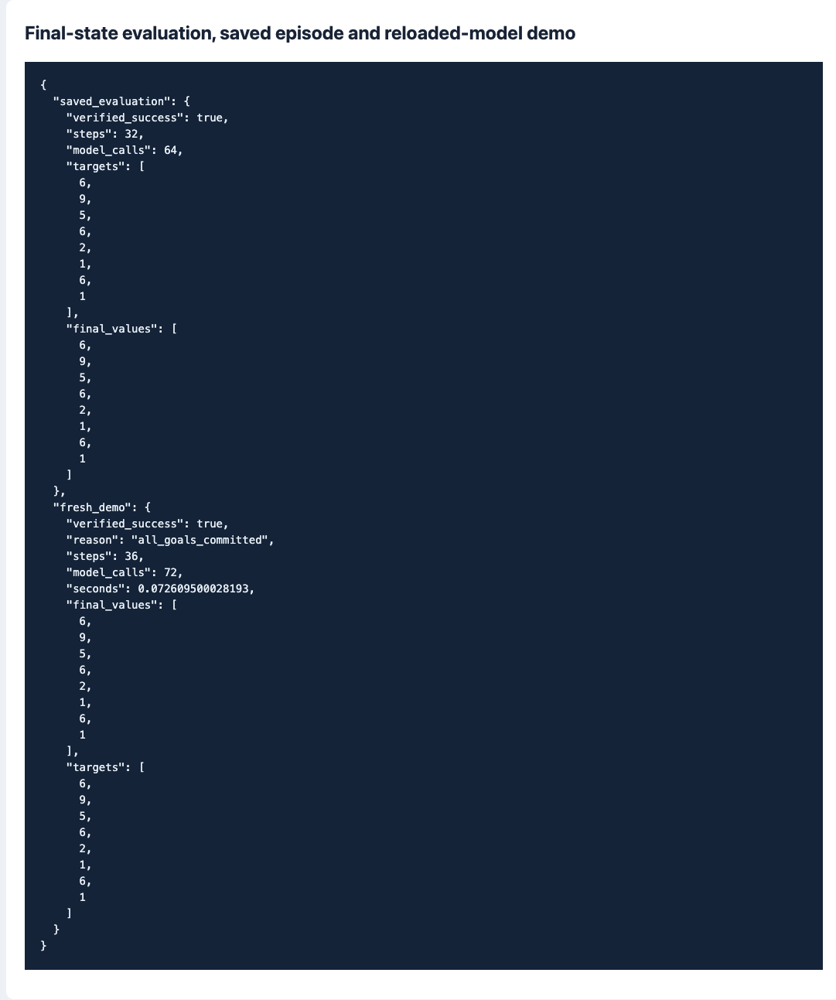

# 第五阶段：可验证环境、长程智能体与自评循环

[总任务表](../../README.md) · [上一阶段](../04-alignment/README.md)

## 任务清单

- [x] 写可重置环境、三个工具、明确成功条件与失败条件。
- [x] 写 Harness，限制工具、步数和整数范围，保存完整任务轨迹。
- [x] 用验证过的轨迹训练神经网络策略，再用实际环境奖励更新。
- [x] 测试 1、4、8、16 个连续目标，分别比较训练前后与 self-judge。
- [x] 保存策略权重、示范数据、实际轨迹、截图与可重放 Demo。
- [x] 整理五阶段英文报告，使用官方 NeurIPS 2026 模板。

## 任务环境

选择整数账本任务，使状态变化、动作依赖和终止条件都能逐步检查：

```text
当前值：1，目标值：6
允许的工具：
  L：减 1
  R：加 1
  S：提交当前目标

达到 6 并提交后，才会出现下一个目标。
全部目标依次提交且最终数值正确，任务才算成功。
```

模型每次看到当前值和目标，从三个工具中选一个。错误提交、超出 0～9 或耗尽动作预算都会终止任务。环境限定在内存账本中。

| 名词与英文全称 | 实现中的含义 |
| --- | --- |
| Agent，智能体 | 持续观察、调用工具、接收反馈的神经网络策略。 |
| Harness，执行框架 | 校验并执行模型请求，记录每步输入、草稿、实际动作和环境反馈。 |
| Observation / Action，观察 / 动作 | 环境给出的数值状态 / 模型选择的 L、R、S。 |
| Trajectory，任务轨迹 | 一次任务从开始到终止的完整动作与反馈。 |
| Verifier，验证器 | 同时检查所有最终数值、提交顺序和成功终止状态。 |
| SFT — Supervised Fine-Tuning | 从成功轨迹学习下一步动作，以及草稿复查动作。 |
| RL — Reinforcement Learning | 用执行后的终局奖励加权动作对数概率，更新策略。 |
| Self-judge，自我评估 | 同一个模型再读一遍“当前状态 + 自己的草稿动作”，给出复查动作。 |
| CPU — Central Processing Unit | 本次训练和推理都用 CPU 单线程。 |
| Demo — Demonstration | 重新加载保存的权重，现场执行任务并调用外部验证器。 |

环境、神经策略与执行框架都在 [experiment.py](experiment.py)。规则函数生成训练示范，推理阶段由模型选择动作；[测试](test_experiment.py)检查两条路径的隔离。

## 训练记录

| 项目 | 实际设置 |
| --- | --- |
| 起点 | 第四阶段 SFT、种子 42 的 289,248 参数模型 |
| 示范 | 从 1、2、4、8 目标的已验证轨迹得到 10,556 条普通 / 复查训练记录 |
| 轨迹 SFT | 300 次更新，每批 32 条 |
| 环境奖励训练 | 24 个实际采样 episode，逐渐增加到 3 个目标 |
| 奖励 | 终局外部验证成功为 1，否则 0；基线 0.5，熵系数 0.001 |
| 测试 | 每个目标长度 12 个新种子任务，最多 128 次工具动作 |

所有 24 个奖励训练 episode 都已成功。也就是说，这次主要收益来自轨迹监督；不能把最终成功率全归给后面的 RL。

复查提示属于监督训练样本。测试使用新的目标序列，数字状态和工具范围与训练一致。

## 实测结果

表内是完整任务成功数，每格共 12 次：

| 策略 / 条件 | 1 个目标 | 4 个目标 | 8 个目标 | 16 个目标 |
| --- | --- | --- | --- | --- |
| 智能体训练前 | 0 | 0 | 0 | 0 |
| 轨迹 SFT | 12 | 12 | 12 | 12 |
| 轨迹 SFT + 环境奖励训练 | 12 | 12 | 12 | 12 |
| 再加 self-judge | 12 | 12 | 12 | 12 |
| 单独压力测试：10% 草稿扰动、不复查 | 9 | 2 | 2 | 0 |
| 同一扰动设置、增加复查 | 12 | 12 | 12 | 12 |

16 目标任务平均 **68.08 次工具动作**；加复查后动作数没变，模型调用从 68.08 次增至 **136.17 次**。

普通任务全部成功，自评没有继续提高成功率，但增加了计算。10% 草稿随机扰动下，自评提高了成功率；该压力测试与普通任务分开统计。

## 一条实际轨迹

保存的 8 目标评估任务用 32 次动作完成：

```text
目标：     [6, 9, 5, 6, 2, 1, 6, 1]
最终账本： [6, 9, 5, 6, 2, 1, 6, 1]
提交顺序： 0 → 1 → 2 → 3 → 4 → 5 → 6 → 7
外部验证： true
```

完整记录见 [traces.json](reports/traces.json)，包含失败策略和扰动对照，不只保存这一条成功轨迹。

## 复盘

有限状态控制器在新目标序列上完成了长动作链。轨迹监督贡献了主要收益，奖励训练后的成功率保持不变。复查提示的额外计算在扰动条件下有效，但也可能只是重复应用状态到动作的映射；复杂规划和新工具迁移仍需额外任务评估。

## 实际命令与已上传产物

第四阶段模型包解压后：

```bash
cd stages/05-agents
mkdir -p runs
../01-basics/.venv/bin/python -m unittest -v
../01-basics/.venv/bin/python experiment.py --sft-steps 300 --rl-episodes 24 > runs/agent.stdout.json
../01-basics/.venv/bin/python demo.py --self-judge > reports/demo.jsonl
../01-basics/.venv/bin/python ../01-basics/scripts/render_reports.py --stage 05-agents
```

[agent-artifacts.zip](artifacts/agent-artifacts.zip)保存示范、分词器、SFT 权重、最终策略权重与实际轨迹。查看用的模型和数据不用重训：

```bash
unzip -n artifacts/agent-artifacts.zip
../01-basics/.venv/bin/python demo.py --self-judge
```

这条新 Demo 实际执行了 **36 步、72 次模型调用**，最终通过外部验证；[demo.jsonl](reports/demo.jsonl)保留了本次输出。它的初始账本与上面的 32 步评估任务不同。

重训可加 `--output runs/agent-repeat`，不会覆盖保存的模型。

## 英文报告

[英文 PDF](report/paper.pdf) · [LaTeX 源码](report/paper.tex) · [官方模板来源](report/TEMPLATE_SOURCE.txt)

报告包含问题、动机、方法、测量、失败样例和局限，使用官方 NeurIPS（Neural Information Processing Systems）2026 样式的 preprint 模式。编译需 Tectonic；进入 `report/` 后运行 `tectonic paper.tex`。

## 实验截图

**实际训练预算与奖励记录**



**不同任务长度、复查与调用成本**



**实际执行的前后动作及验证**



